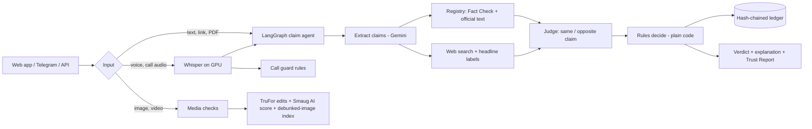
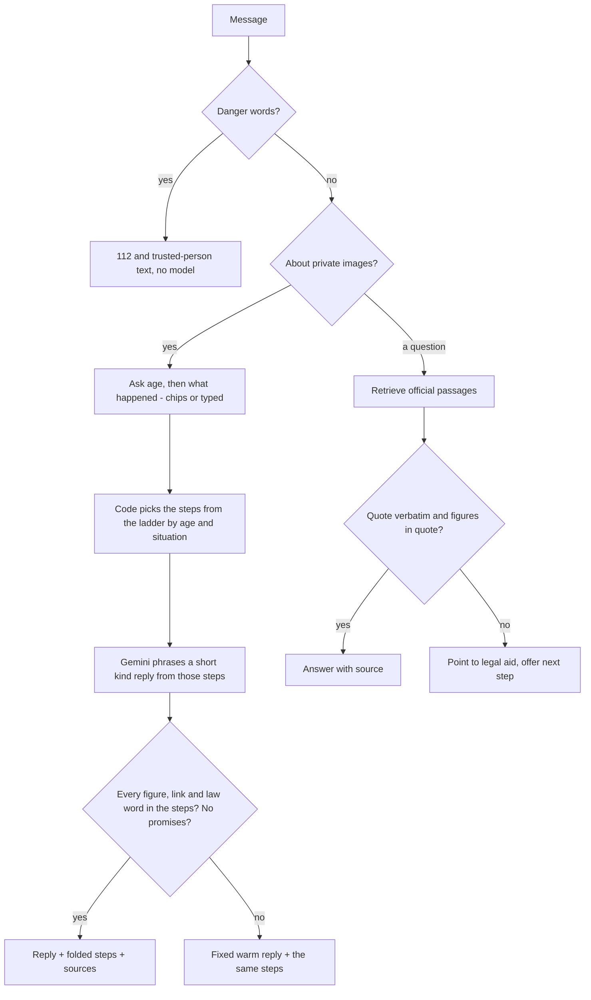

<div align="center">

# SATYASUTRA

**A fact-verification and deepfake audit engine for Indian social media,<br>built in the open with live sources only.**

[](https://github.com/aadamaftabpersonal-boop/FORGEHackathon/actions/workflows/ci.yml)


Hackathon Theme 1, Civic Pulse (problem statement 4) &nbsp;|&nbsp; this repository, FORGE, is where it was built

[The problem](#the-problem) &nbsp;·&nbsp; [What it does](#what-it-does) &nbsp;·&nbsp; [Status](#status-at-a-glance) &nbsp;·&nbsp; [How it decides](#how-a-claim-is-decided) &nbsp;·&nbsp; [Accuracy](#how-well-does-it-work) &nbsp;·&nbsp; [Run it](#run-it) &nbsp;·&nbsp; [Limits](#known-limits)

</div>

---

You give it a claim, a forwarded message, a link, a PDF, a photo, a video, a voice note or a screenshot of a notice. It checks what it can
against live sources and tells you what it found, with every source shown. When nobody reliable has checked a claim it says
**"cannot tell"** and does not guess. Every verdict is written to a tamper-evident ledger.

Beyond fact-checking, it carries two safety tools for the harms that travel with misinformation in India: **Call guard**, which listens to a
suspicious phone call and warns when the words follow a scam script, and **Private help**, a quiet page of next steps for someone whose private
pictures are being shared or threatened.

| | |
|---|---|
| Languages | English, Hindi, Kannada (claims and voice); Telugu and others through Gemini, less tested |
| Inputs | text, link, PDF, image, video, voice note, notice photo, live call audio |
| Interfaces | web app, Telegram bot, JSON API |
| Data policy | **no mock, static or hardcoded data in product code**; enforced by `scripts/check_no_fixtures.py` |
| Tests | 624 unit tests (live-network contract tests are separate); one timing-sensitive live-server test is flaky under full-suite load and passes alone |
| Pages | one page per check (`/check/claim`, `/photo`, `/notice`, `/voice`, `/link`), Call guard, Private help (Raksha), Trust Report, investigator views |

> [!IMPORTANT]
> **Read this first.** This is a hackathon prototype. Section [How well does it work?](#how-well-does-it-work) gives the measured numbers,
> including a held-out test where one of our rules **failed** its own pass criteria. Section [Known limits](#known-limits) lists what we did not test.
> Nothing here is claimed beyond what those sections say.

### At a glance

<table>
<tr>
<td width="33%" valign="top"><b>Claims</b><br>Paste a claim in English, Hindi or Kannada. Watch each step run live, then read a verdict with its sources, or an honest "cannot tell".</td>
<td width="33%" valign="top"><b>Photos, video, voice</b><br>Tamper heatmaps, AI-generated scores, matches against images fact-checkers already debunked, transcripts and synthetic-voice checks.</td>
<td width="33%" valign="top"><b>Notices, links, PDFs</b><br>Scam wording, look-alike links and official-text mismatches, read without ever opening the links.</td>
</tr>
<tr>
<td valign="top"><b>Call guard</b><br>Listens to a suspicious call and turns amber or red as the words follow a scam script, with advice for that scam.</td>
<td valign="top"><b>Raksha</b><br>A kind, sourced chat for someone whose private pictures are threatened or shared. It asks two questions, then gives the steps in order.</td>
<td valign="top"><b>Trust Report</b><br>One shareable page per investigation, built only from records this server produced, plus Hindi and English correction cards.</td>
</tr>
</table>

---

## Contents

1. [The problem](#the-problem)
2. [What it does](#what-it-does)
3. [Status at a glance](#status-at-a-glance)
4. [How a claim is decided](#how-a-claim-is-decided)
5. [Architecture](#architecture)
6. [Features in detail](#features-in-detail)
7. [How well does it work?](#how-well-does-it-work)
8. [Safety, privacy and ethics](#safety-privacy-and-ethics)
9. [Run it](#run-it)
10. [Deploying it](#deploying-it)
11. [Using the website](#using-the-website)
12. [API](#api)
13. [Repository layout](#repository-layout)
14. [Known limits](#known-limits)
15. [Roadmap](#roadmap)
16. [Credits and licences](#credits-and-licences)

---

## The problem

Misinformation in India spreads in private channels (WhatsApp family groups, Telegram, regional-language video) faster than fact-checkers can reach it, and
it arrives in forms that are hard to check by hand: a forwarded voice note, a photo that looks real, a "government notice" in a screenshot. The same
channels carry scams (the so-called digital-arrest calls, fake KYC messages) and image-based abuse. A tool that is useful here has to:

- work in the languages people actually use, on a phone, in seconds;
- show its evidence, so a person can judge it, instead of asking to be trusted;
- say "cannot tell" when it cannot, because a confident wrong answer does more harm than silence;
- never become a surveillance or harassment tool itself.

SATYASUTRA is our attempt at that. The design rules are in `docs/plan/`; the working notes are in [`CLAUDE.md`](CLAUDE.md).

## What it does

| You have | You get |
|---|---|
| A claim or forwarded message (any language) | A verdict (true, false, misleading, or cannot tell) with the sources behind it, shown live as each step runs |
| A link or a PDF circular | The page read safely, its links and wording checked, and its text sent to the claim check |
| A photo | A tamper heatmap and score, an AI-generated-image score, a match against images already debunked by fact-checkers, and the file's metadata |
| A video | Eight sampled frames checked the same way |
| A voice note | A transcript (Whisper), the claim check on what was said, and a synthetic-voice check |
| A screenshot of a notice | The printed text, issuer, links and requests copied out, then checked for scam wording, look-alike links and official-text mismatch |
| A suspicious phone call | **Call guard**: amber or red on your screen as the call goes on, with advice for that scam type |
| Private pictures leaked or threatened | **Raksha** (`/help`): a chat that asks two questions (your age, what happened), then gives a short, kind plan with the steps in order, sourced from official documents, plus a ladder of who to approach and a letter drafter; nothing stored, no pictures ever requested |
| Any check | A shareable **Trust Report**, a correction card (English or Hindi), and a "what to do next" plan |

## Status at a glance

An honest split between what runs today, what runs with stated weaknesses, and what is not built. **Built** means it runs end to end; it does not mean it is accurate on every input.

| Capability | Status | Note |
|---|---|---|
| Claim agent (extract, registry, web, judge, rules, ledger) | Built, measured | Held-out numbers below; coverage is low by design |
| Hindi and Kannada claims | Built, lightly tested | Hindi wording of our own text is unreviewed |
| Image forensics (edits, AI-generated, debunked-image index) | Built, calibrated on small sets | False-alarm rate on real social-media images unknown |
| Video | Built, weak | Compression hides splices; face swaps and AI video not detected |
| Voice note transcript and synthetic-voice check | Built, weak test data | No cloned real voices in the test |
| Notice, link and PDF checks | Built | Real photographed notices not tested |
| Call guard | Built | Tested on scripts we wrote, not real calls |
| Raksha grounded guide, ladder, letters | Built | Statute and IT Rules text not in its sources; Hindi and legal wording unreviewed |
| Telegram bot | Built | Needs the API running; a fresh token is in use |
| Trust Report, history, command centre | Built | No sign-in, so the command centre is local only |
| What is spreading (India pulse) | Built | Media and search attention, not WhatsApp |
| Public deployment | Prototype | A Vercel front door proxying to the machine that runs the app; see [Deploying it](#deploying-it) |
| WhatsApp and X ingestion, reverse image search, official PIB/MoHFW feeds, counselling and takedown handling | Not built | See [Roadmap](#roadmap) |

## How a claim is decided

Two principles run through the whole system.

**1. Only reliable evidence can decide a claim.** Evidence is tiered. Tier 1 is an official source (RBI and SEBI releases). Tier 2 is a fact-checker or a
reputable outlet. Tier 3 is everything else, which is shown but never decides. A claim is **REFUTED** or **SUPPORTED** only on Tier 1 or 2 evidence, and
**UNVERIFIABLE_YET** ("cannot tell") is a normal, correct result.

**2. Models read, code decides.** Gemini is used to extract claims, translate, say whether a fact-check is about the same claim, and label news headlines. It
never chooses the verdict. The mapping from evidence to label is plain, testable code (`claims/rules.py`), and the explanation shown to the user is exact
(Shapley credit per evidence item), because the rules are code, not a model.

The verdict labels for claims are SUPPORTED, REFUTED, MISSING_CONTEXT, UNVERIFIABLE_YET and NOT_A_CLAIM. Media never gets an "authentic" label: the options
are EDITED, SYNTHETIC_SUSPECTED, OUT_OF_CONTEXT or INCONCLUSIVE, because a clean detector result is only weak evidence.

### The evidence routes

| Route | What it does | What decides |
|---|---|---|
| Fact Check API | Finds published fact-checks of similar claims | Only a review of the *same* claim from a trusted source, judged by Gemini or a local NLI model, and only with matching negation |
| Official text | RBI press releases and SEBI feed in a local full-text index | A claim that quotes a different number than the official release is REFUTED (`claims/contrast.py`: both number spans must appear verbatim, parse to one number each, and differ beyond a tolerance; a number that also appears elsewhere in the passage blocks the refutation) |
| Web search | Searches live news for the claim | Two or more distinct reputable outlets reporting it as fact give SUPPORTED (medium at most); a fact-checker, or two reputable outlets, calling it false give REFUTED; a claim worded as "tonight" or "today" whose agreeing coverage is old, or a forecast, is not counted as support |
| Wikidata | Grounds named entities | Context only, never evidence |
| Sensitive topics | Communal, caste and election claims | The label is held back to "cannot tell" with a `HUMAN_REVIEW` flag |

## Architecture



- **API and UI:** FastAPI (`src/satyasutra/api/app.py`) serves JSON, server-sent events and the static pages in `ui/`. `GET /agent/stream` shows each node and tool call live.
- **Claim agent:** a real LangGraph graph (`agent/graph.py`): read post, extract, then registry and web in parallel, then judge, then decide. It stops early if there is no checkable claim.
- **GPU service:** `forensics/service.py` (Python 3.11, CUDA) runs TruFor (edits), Smaug (AI images), faster-whisper (speech), a wav2vec2 synthetic-voice detector and an mDeBERTa NLI model. If it is down, speech falls back to CPU.
- **Ledger:** SQLite, hash-chained and append-only; `GET /ledger/verify` walks the chain and reports the first bad row.
- **Fast clock:** a no-model front end that clusters near-identical posts from a live stream by MinHash, ranks them by spread, and sends only the fastest to the agent, so model calls stay within the free quota. Off by default; Bluesky only.
- **Resilience:** Gemini calls retry once and fall back to the next model, then to a local NLI model for the "same claim?" step. Out of quota is said plainly: nothing is guessed.

## Features in detail

### Claim checking
Gemini extracts checkable claims (quotes must appear verbatim in the post), translates to English and keeps the original quote. Hindi and Kannada go through the same agent. Results stream live, then a verdict card shows the sources, the Wikidata entities and a "Why this verdict" panel with each evidence item's exact credit.

### Media forensics
- **Edits (TruFor, GRIP-UNINA):** heatmap and score; labelled EDITED at or above 0.7, otherwise INCONCLUSIVE.
- **AI-generated images (Smaug):** SYNTHETIC_SUSPECTED at or above 0.5. One detector alone never gives a firm label.
- **Debunked-image index:** 117 images from fact-check feeds matched by perceptual hash (PDQ). A match means "appeared in a fact-check", never "false".
- **Video:** eight frames, same checks. Face swaps and AI-generated video are **not** detected.
- **Voice:** transcript plus a synthetic-speech label (SYNTHETIC_SUSPECTED on the median six-second window), never "real".

### Notices, links and scams
A screenshot of a notice is read by Gemini vision (copying only); code checks link names against 27 official domains (links are never opened), scam wording, and whether an RBI or SEBI claim matches the official index. The result is findings, not a verdict.

### Call guard (`/guard`)
Listens through the phone's microphone in six-second pieces (or typed words), transcribes, and applies plain word rules for how scams are built: an authority, a threat, urgency, secrecy, a request for a code or money, remote access. A bank's real "never share your OTP" warning does not alert. States: listening, be careful, this looks like a scam. A red alert shows advice for that scam type, buzzes the phone, reads the warning aloud, and offers a one-tap message to someone you trust (you choose the app and the contact). Sessions are in memory only and expire; nothing is stored. It never says a call is safe.

### Raksha: private help (`/help`, Telegram `/help_me`, `/ladder`, `/ask`, `/draft`)
For someone whose private pictures are being threatened, shared or faked. It is built so the person is spoken to like a person, and so every fact in the answer is checked.

- **A conversation, not a form.** Typing something like "my boyfriend is threatening to leak my nudes" is met with a warm line and one question (were you 18 or older when the pictures were taken; unsure counts as under 18, and an age is never guessed). If it is not clear, one more question follows (a threat so far, already shared, or faked). Short typed answers work as well as the buttons.
- **A short, kind plan.** From those two answers, plain code picks the first steps from the ladder (adults start with StopNCII, under 18 with Take It Down, then the cyber-crime portal and the platform's grievance officer). Gemini only phrases the reply, in a friend's voice, from those vetted steps. The reply is kept only if every figure, link and law-like word in it appears in the steps and it promises no outcome; otherwise a fixed warm reply is shown with the same steps. Steps are folded under the reply with their source; buttons offer the letter or the full ladder.
- **Grounded answers.** Questions ("how long do I have to appeal to the Grievance Appellate Committee?") are answered from a local corpus of official documents (GAC, CPGRAMS, NALSA, I4C and Delhi Police pages, Sanchar Saathi, StopNCII, Take It Down) held in a hash-verified index. Gemini picks and phrases; code keeps a sentence only if its quote is verbatim in the cited passage and every figure is in the quote. If nothing survives, the reply points to a lawyer or legal-aid service and offers the next step instead of guessing.
- **A ladder.** Delhi first: who to approach, in order, each rung with quotes re-checked against the index on every request.
- **Letters.** Complaint, follow-up and escalation letters in English and Hindi, filled from what the person types. No model writes them.
- **Safety first.** Danger words ("I want to die", "he is outside") get the 112 and trusted-person text before any retrieval or model call. A message in distress gets a warm reply and options, not a document search.
- **What it never does.** It never asks for, accepts, stores or checks pictures, files nothing, and gives no legal advice. The conversation state lives in the page; the server keeps nothing. The page has a one-tap exit that returns to the previous page.



### Trust Report, history and command centre
Every check saves a server-side record. A **Trust Report** (`/report/<id>`) is one shareable page with ten sections, built only from records this server produced, with a content-hash id. `/my-investigations` keeps your history in your browser and lets you delete it. `/command` is a view for investigators: overview, evidence graph, media lab, claim groups across languages, a source registry and a case workspace. There is no sign-in, so the command centre shows every record on that server.

### What is spreading
`/officials` reads 23 live Indian feeds (Google Trends India, the newest articles of BOOM, Alt News, Factly, Vishvas News and Newschecker, and top headlines of Indian outlets in English, Hindi and Kannada), clusters them, and marks disaster-related topics first. It is a window on media and search attention, **not** on WhatsApp.

## How well does it work?

We built a labelled claim dataset (`tests/eval/`), split by hash into **dev** (used while building) and **test** (run once on a frozen, tagged version).
Numbers describe one version on one day and come with 95 percent ranges, because the sets are small.

**Held-out test split, run once on 2026-11-01** (tag `eval-freeze-2026-11-01`, lookup off, 62 rows, 0 errors; [`docs/claim-sheet-test.md`](docs/claim-sheet-test.md)):

| Measure | Result |
|---|---|
| True claims called false | 0/15 |
| False claims called true | **1/24** (4%, 1 to 20%) |
| False claims refuted | 12/24 (50%) |
| Claims that got a decided label (coverage) | 14/62 (23%) |
| Unknowable claims answered "cannot tell" or "not a claim" | 23/23 |
| Median / 95th percentile seconds per claim | 11.7 / 24.2 |

**The web-search rule failed its own pre-written pass criteria** ([`docs/WEB_RULE_CRITERIA.md`](docs/WEB_RULE_CRITERIA.md)). A row built to fool it, the 2016
demonetisation worded as if announced tonight, was called SUPPORTED because reputable outlets reported that event as fact. We recorded the failure beside the
numbers and added a recency check afterwards. That check is unit-tested but **not measured on held-out data**, and it only catches claims that contain a "now" word.
A second fix (outlets reporting a forecast do not confirm it) came from a dev row and is likewise not held-out evidence.

| Other measurements | Result | Where |
|---|---|---|
| Dev split, lookup off (32 rows) | 0 true claims called false, 0 false called true, 7/12 false refuted, coverage 7/32 | [`docs/claim-sheet.md`](docs/claim-sheet.md) |
| Dev split, fact-check lookup on | 29 of 32 scored, 0 wrong | [`docs/claim-sheet-factcheck-on.md`](docs/claim-sheet-factcheck-on.md) |
| TruFor, after sharing (shrunk, JPEG) | flags 63% of spliced and 30% of copy-moved photos, 7% of untouched | [`docs/calibration/`](docs/calibration) |
| Smaug AI-image detector | 36/40 AI images caught, 1/40 real flagged | [`docs/calibration/`](docs/calibration) |
| Synthetic-voice detector | 19/19 fakes caught, 0/20 real flagged (weak test) | [`docs/calibration/`](docs/calibration) |
| Call guard (32 written scripts) | 15/16 scams reach red, 1/16 ordinary calls false-alarm | [`docs/guard-sheet.md`](docs/guard-sheet.md) |
| Raksha recognition (40 messages) | 19/20 caught, 0/20 false triggers | [`docs/raksha-sheet.md`](docs/raksha-sheet.md) |
| Raksha grounded guide (25 questions, one labeller) | retrieval 14/14, correct answers 12/14, refusals 11/11 | [`docs/raksha-rag-sheet.md`](docs/raksha-rag-sheet.md) |
| Load on the free Gemini tier | one claim check costs 4 model calls: about 3 checks a minute for everyone; 3 simultaneous users wait 37 s (median) | [`docs/load_gemini.md`](docs/load_gemini.md) |

The Raksha plan reply (the conversation that asks age and what happened) has not been measured on a labelled set; it is covered by unit tests and live spot checks. Call guard and Raksha scores are **optimistic**: we wrote the rules and the test sets together, and adjusted the rules after the first run. Face-swap classifiers
were tested on FaceForensics++ and rejected (6 of 18 real videos flagged), so nothing is shown for them.

## Safety, privacy and ethics

- **We never file to a government portal, defeat a CAPTCHA or bypass a login.** Our client states what it is; sources that refuse it (PIB, MoHFW, PMIndia, cybercrime.gov.in answer 403) are not used.
- **Do not present unverified facts as verified.** "Cannot tell" is a result; media checks never say "authentic"; Call guard never says a call is safe.
- **Grounded, not improvised, where it matters most.** Raksha only states what a retrieved official passage says, checks every quote and figure in code, and refuses rather than guesses; its model-written plan reply is rejected if it adds a figure, link, law or promise.
- **Private by design where it matters.** Telegram requests carry a private header and are not stored; text about leaked private images is refused by the claim endpoints (409) and never stored; Call guard audio is transcribed and dropped; `/help` is served with no caching and has a one-tap exit; stored checks can be deleted from the server and the browser.
- **Honest limits.** `GET /agent/stream` carries the text in the URL, so server access logs see it; Telegram keeps its own chats; the command centre has no sign-in. Whether listening to a call on speaker is allowed varies by place, and the Call guard page says so.
- **Secrets.** Keys live only in a git-ignored `.env`; error text reports exception class names, never URLs that could contain a key. Tests assert this.
- **Licences.** TruFor is for informational and non-profit use with credit; see [Credits](#credits-and-licences).

## Run it

Needs Windows, Python 3.14 for the API, Python 3.11 with CUDA for the GPU service, and ffmpeg on the PATH. Keys go in a git-ignored `.env`
(names in `.env.example`): `GEMINI_API_KEY`, `GOOGLE_FACTCHECK_API_KEY`, `FORGE_CONTACT`, and optionally `DATA_GOV_IN_API_KEY` and `TELEGRAM_BOT_TOKEN`.

```powershell
python -m venv .venv ; .\.venv\Scripts\pip install -e ".[dev]"
.\scripts\start_demo.ps1                          # starts the GPU service and the API, then checks everything
.\.venv\Scripts\python scripts\serve.py --port 8000    # or just the API and UI, with the live stream worker on
.\.venv\Scripts\python scripts\telegram_bot.py    # optional, needs the API running
```

Models are not in the repository (`models/` and `forensics/` are git-ignored): Whisper small, the synthetic-voice detector, mDeBERTa NLI and the TruFor and
Smaug weights are downloaded separately; [`docs/licences.md`](docs/licences.md) says where from.

```powershell
.\.venv\Scripts\python -m pytest -q                        # unit tests
.\.venv\Scripts\python -m pytest -q -m contract            # live contract tests (need keys and network)
.\.venv\Scripts\python scripts\check_no_fixtures.py        # the no-hardcoded-data guard
.\.venv\Scripts\python scripts\preflight.py                # keys, sources, services, indexes, ledger
.\.venv\Scripts\python scripts\eval\run.py --split dev --factcheck off --official snapshot --out docs\claim-sheet.md
```

> [!NOTE]
> The test split needs a clean git tree on the guarded paths and is meant to be run once per frozen version.

## Deploying it

The app needs the GPU service, SQLite files and long-lived streams, none of which fit serverless functions. The prototype deployment therefore keeps the work on the machine that runs the app and puts a public front door in front of it:

```powershell
ngrok http 8000                                              # a public tunnel to the running API
.\.venv\Scripts\python scripts\make_vercel.py https://<your-tunnel-host>
cd deploy\vercel ; vercel deploy --prod
```

> [!WARNING]
> The public address depends on your machine, the API and the tunnel staying up, and it has no sign-in. Anyone with the link spends the Gemini free quota.

`scripts/make_vercel.py` writes `deploy/vercel/vercel.json`, which proxies the public pages and APIs to the backend. The command centre, intel, registry and case pages are **not** proxied (the app has no sign-in and they show every stored record), so they return 404 on the public address. The site is up only while the machine, the API and the tunnel are up. Anyone with the link spends the Gemini free quota. Request-size limits for photo, video and voice uploads through the proxy were not measured.

## Using the website

Open http://127.0.0.1:8000/. The home page links to one page per check, and the top bar links to everything.

1. **Check:** paste a claim, link or PDF, upload an image or video, or record a voice note, then press **Investigate now**. You see each step live, then the verdict with its sources. After a check you can build a Trust Report, make a correction card, or **delete these checks**.
2. **Call guard:** open `/guard`, read the notice, press **Start listening** and put the call on speaker. Or type what the caller says and press **Check**. Amber means be careful; red means hang up.
3. **Private help:** open `/help` and tell Raksha what is happening in your own words, or pick an option. Use the tabs for the first steps, the ladder of who to approach, and a letter. Press **Close this page now** to leave at once; it returns you to the page you came from.
4. **My investigations:** your history, kept in your browser; delete any item.
5. **What is spreading** and **Command centre:** the investigator views.

On Telegram, send text, a voice note or a photo to the bot; send `/help_me` (Hindi `/madad`) for the guided support flow and `/forget` to clear it. `/ladder [minor]` lists who to approach, `/ask <question>` answers from the official documents, and `/draft <kind>` makes a letter.

## API

Interactive docs at `/docs` when the server runs. The main routes:

| Route | Purpose |
|---|---|
| `POST /verify` | Check a text or a Bluesky post; returns verdicts and writes ledger rows |
| `GET /agent/stream?text=` | The claim agent as server-sent events, step by step |
| `POST /media/check`, `/video/check`, `/audio/check` | Image, video and synthetic-voice checks (raw bytes) |
| `POST /voice/transcribe` | Speech to text (raw audio, up to 120 s) |
| `POST /notice/check`, `/url/check`, `/doc/check` | Notice screenshot, public page, PDF |
| `GET /links/check?text=` | Lookalike-link check on link names |
| `GET /news/check?text=` | Recent headlines for a claim (context only) |
| `POST /act/plan`, `POST /card/spec` | "What to do next" plan, correction-card spec |
| `POST /raksha/chat`, `/raksha/ask`, `/raksha/draft`, `GET /raksha/ladder` | Raksha conversation, grounded answers, letters, the ladder |
| `POST /guard/chunk`, `/guard/text`, `DELETE /guard/{id}` | Call guard (audio or typed words; end a session) |
| `POST /report/build`, `GET /report/{id}` | Build and open a Trust Report |
| `DELETE /records/{id}` | Delete a stored investigation |
| `GET /ledger/verify`, `/ledger/{seq}` | Check the ledger chain; read one entry |
| `GET /pulse`, `/officials/data`, `/fastclock/top` | What is spreading |
| `GET /health`, `/health/sources` | Service and source reachability |

## Repository layout

```
config/       policy.yaml, thresholds.yaml, runtime.yaml, sources.yaml, prompts/, actions.yaml, raksha.yaml, raksha_rag.yaml, escalation.yaml, raksha_drafts.yaml, scam_script.yaml, cards.yaml
src/satyasutra/
  api/        FastAPI app and routes          agent/      LangGraph claim agent and trace
  claims/     extract, rules, judge, contrast, web, nli, entities
  sources/    fact-check, official, news, web search, wikidata, probes
  media.py, video.py, audio/, voice/            media forensics, speech, synthetic-voice checks
  scam/, raksha/, act/                          Call guard; Raksha (corpus, grounded ask, ladder, drafts, situation chat); next-step plans
  ledger/, records.py, report.py, intel.py      ledger, stored records, Trust Report, command-centre data
  fastclock/, ingest/, pulse.py                 stream clustering and the India pulse
  schemas/, config.py, errors.py                typed data, strict config, typed errors
forensics/    GPU service (TruFor, Smaug, Whisper, NLI); weights and venv are git-ignored
ui/           static pages: checker, guard, help, report, history, command centre
scripts/      serve, preflight, probes, calibration and evaluation scripts, the no-fixtures guard
tests/        unit, contract (live), eval (the claim dataset), guard, raksha
docs/         plan/, PHASES.md, calibration/, claim sheets, PITCH.md, DEMO_RUNBOOK.md, licences.md
deploy/       vercel.json generator target (the Vercel front door)
tools/        forge.py: the phase and ticket board
```

## Known limits

> [!CAUTION]
> The numbers above describe one version on small sets. Treat them as evidence of how the system behaves, not as a guarantee of accuracy on your input.

- **Accuracy is measured on a small set.** 62 held-out rows, mostly finance claims, one labeller for most groups. The set cannot show rare failures, and coverage is low: most claims end as "cannot tell".
- **The web rule has a known weakness.** An outlet reporting a rumour, or old coverage of an event stated without a "now" word, can still be mistaken for confirmation. The outlet lists and counts are policy choices, not calibrated.
- **Gemini free tier.** About 15 calls a minute per model plus a daily limit; at roughly 3 claim checks a minute, a live demo should have no more than about 3 people checking at once.
- **Media.** A clean TruFor or Smaug result is weak evidence; false-alarm rates on real social-media images are unknown; face swaps and AI-generated video are not detected; the synthetic-voice test has no cloned real voices.
- **Hindi and Hinglish wording is ours and not reviewed by a native speaker** (Call guard, Raksha, correction cards, Trust Report).
- **Raksha's sources.** The statute and IT Rules text is not in its corpus (those hosts refuse our client; the PDFs must be added by hand), so it cannot quote the law, and the section on voice and social-media impersonation is not built. Coverage is Delhi first. Hindi and legal wording is unreviewed.
- **Call guard and Raksha** were tested on text we wrote, not on real calls or real messages. The next-step routes (1930, cybercrime.gov.in, Chakshu) come from secondary sources and are marked unconfirmed, because the official sites refuse our client.
- **Networks.** The optional live stream is Bluesky only; nothing here sees WhatsApp.
- **Not read or not tested:** the terms of use of the news outlets and Google News, real photographed notices (skew, glare), JavaScript-built pages, real-speaker Kannada.

## Roadmap

Not built, or only sketched: a "where reported" timeline for each claim; names and places in the contrast check; more language rows and a native-speaker review; WhatsApp and X ingestion (needs official access); reverse image search (paid APIs); adding the statutes and IT Rules to Raksha's corpus, other states' ladders, and a lawyer review of its wording; counselling, takedown handling and legal advice for the private-image flow; official PIB, MoHFW and PMIndia sources (needs an official access route); sign-in and per-user records for the command centre; a paid model tier for real load.

## Credits and licences

- **TruFor** (GRIP-UNINA, University Federico II of Naples): edit detection and heatmaps. Informational and non-profit use; credit required.
- **Smaug AI-Image-Detector** (Abacus.AI, Apache 2.0): AI-generated image score.
- **Whisper** (OpenAI, MIT) through faster-whisper (Systran); **mDeBERTa-v3 NLI** (Moritz Laurer, MIT); **wav2vec2 deepfake voice detector** (garystafford, Apache 2.0).
- **Noto Sans Devanagari** (Google, SIL Open Font License). Full table, including what was not read: [`docs/licences.md`](docs/licences.md).
- Data from the Google Fact Check Tools API, Wikidata, Wikimedia Commons, Bluesky Jetstream, RBI and SEBI feeds, Google News RSS, and the public RSS feeds of the outlets named in `config/runtime.yaml`.
